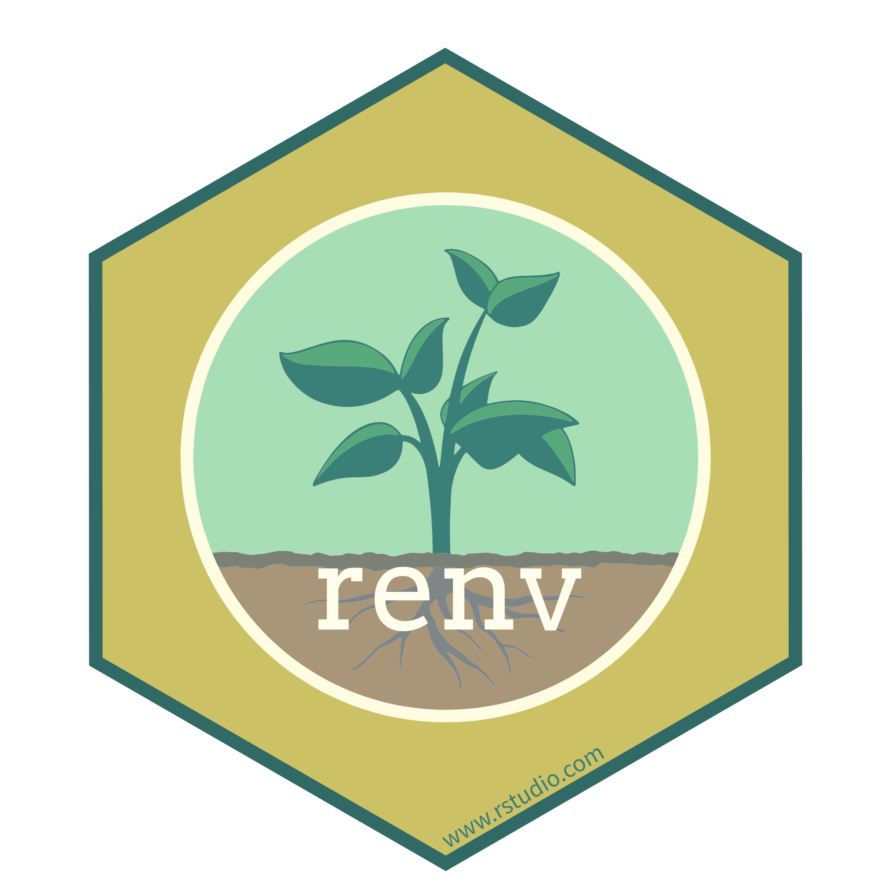
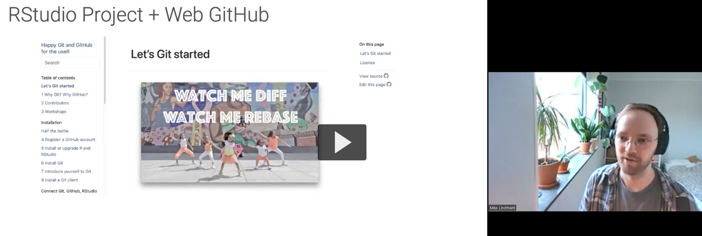

## 🪦 R.I.P 🪦

- `gather()`/`spread()`
  - `pivot_longer()`, `pivot_wider()`
- `geom_line(size = x)`
  - `geom_line(linewidth = x)`
- `legend.position()`
  - `guide_legend(position = inside) + theme(legend.position.inside = c())`
- `data_frame()`
  - `tibble()`

## How to make old projects run?

- Use base R as much as possible
  - let the first person to drop `ggplot2()` take the lead...
- Document R package versions and install globally when re-running
  - introduces other issues and means lots of installing back and forth!
- ... What about project-specific libraries?
  
## `renv`
{height="200"}

- R package for managing project-specific package libraries
- Creates isolated, reproducible environments for each project
- Records package versions and dependencies

## Prerequisites
- Project-oriented lifestyle
- Version control system (Git, GitHub)
- Previous recordings at [play.slu.se](https://play.slu.se/playlist/dedicated/652980/0_r32sc5wo/0_b8sfgjcr)

{height="300" fig-align="center"}

## .. Quick recap:
- "GitHub first, project later"
1. Make repository on GitHub
2. Clone using the web URL
3. Create a new RStudio project (version control)
4. Paste link
5. Make changes locally and push


## Basic workflow

```r
# Ready to package project?

# Initialize renv in your project, adds three files
renv::init()

# Update lockfile with metadata about used packages in the project library
renv::snapshot()
```

## What `renv::init()` creates

```
📁 home-dir/
   ├── 📄 renv.lock
   ├── 📁 renv/
   └── 📄 .Rprofile
```

- `renv.lock`: metadata about every package so that it can be re-installed on a new machine
- `renv/library`: library that contains all packages currently used by your project
- `.Rprofile`: run automatically, renv uses it to configure your R session to use the project library

::: notes
This is the key magic that makes renv work: instead of having one library containing the packages used in every project, renv gives you a separate library for each project. This gives you the benefits of isolation: different projects can use different versions of packages, and installing, updating, or removing packages in one project doesn’t affect any other project.
:::

## Workflow

::: {.columns}
::: {.column width="50%"}

#### **Person A**

1. Initialize project with `renv::init()`
2. Run `renv::snapshot()`
3. Push
:::

::: {.column width="50%"}

#### **Person B**

1. Clone the repository
2. Open project in RStudio
3. Run `renv::restore()`. Extremely fast because it checks the difference between the lockfile and globally installed packages
4. Does not affect globally installed packages
:::
:::

## Common issues & solutions

- This works great for packages on CRAN
- `INLA` stubbornly not on CRAN (but now not needed due to `fmesher`)
- `rnaturalearthhires` containing maps are too large for CRAN
  -  try `renv::snapshot(type = "all")` to tell `renv` not too look at CRAN 

## When to use renv?

- Collaborative projects: Everyone needs the same package versions
- Long-term projects: Don't make others and future you have to reinstall older versions globally...
- Publication/Analysis code: Make your research reproducible
- Teaching materials: Students get a consistent environment
- Quick exploratory analysis: Maybe overkill

## Quick demo